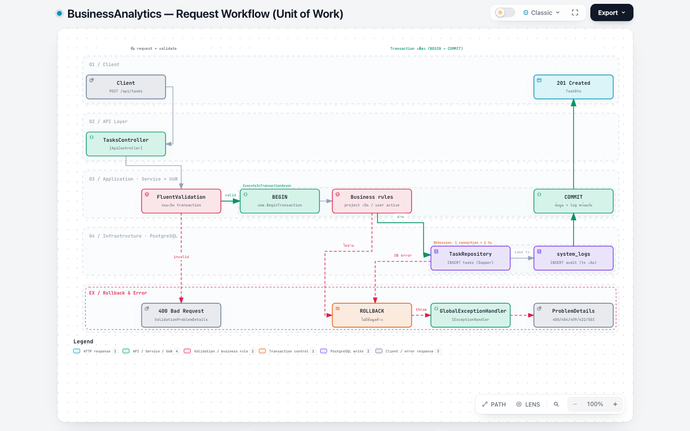

# Containerized Business Analytics System

ระบบ Backend API สำหรับจัดการและวิเคราะห์ข้อมูลโครงการ (Project Monitoring)
.NET 8 · Clean Architecture · **Unit of Work + Repository** · Dapper + Npgsql · PostgreSQL 16 · Docker Compose · Bash ops scripts

---

## Quick start (One-command setup)

```bash
cp .env.example .env        # optional: ไม่ copy ก็ใช้ค่า default ได้
docker compose up -d --build
```

| URL | |
|---|---|
| http://localhost:8080/swagger | Swagger UI (API document) |
| http://localhost:8080/health | Readiness (เช็ค DB ด้วย) |
| http://localhost:8080/health/live | Liveness |

ตอน `up` ครั้งแรก PostgreSQL จะรัน `db/init/01_schema.sql` และ `02_seed.sql` อัตโนมัติ (สร้าง schema + ข้อมูลตัวอย่าง 11 users / 8 projects / 120 tasks)
ถ้าต้องการ init ใหม่ทั้งหมด: `docker compose down -v && docker compose up -d --build`

รัน unit tests (ไม่ต้องมี DB):

```bash
dotnet test
```

---

## Architecture

```
src/
├── BusinessAnalytics.Domain          Entities + business invariants (ไม่มี dependency)
├── BusinessAnalytics.Application     Use-cases (services), DTOs, FluentValidation,
│                                     IUnitOfWork / IRepository interfaces, CSV export
├── BusinessAnalytics.Infrastructure  Npgsql + Dapper: DbSession, UnitOfWork, Repositories, SQL reports
└── BusinessAnalytics.Api             Controllers, Global exception handler (ProblemDetails),
                                      Swagger, Health checks
tests/BusinessAnalytics.UnitTests     xUnit + Moq (commit/rollback behaviour, validators, CSV)
```

Dependency ชี้เข้าด้านในเสมอ: `Api → Infrastructure → Application → Domain`

### Unit of Work



แผนภาพแบบ interactive: [`docs/diagrams/uow-request-workflow.html`](docs/diagrams/uow-request-workflow.html) (สร้างด้วย archify)

```
          HTTP request (scoped)
                 │
           ┌─────▼─────┐
           │  Service   │  uow.ExecuteInTransactionAsync(...)
           └─────┬─────┘
                 │
          ┌──────▼───────┐      Users / Projects / Tasks / SystemLogs / Reports
          │  UnitOfWork   │────► repositories
          └──────┬───────┘             │
                 │                     │  ใช้ connection + transaction เดียวกัน
            ┌────▼─────┐◄──────────────┘
            │ DbSession │  NpgsqlConnection (1 ต่อ request) + NpgsqlTransaction
            └──────────┘
```

- `DbSession` (scoped) ถือ connection เดียวต่อ request และ transaction ปัจจุบัน — ทุก repository รับ `DbSession` ตัวเดียวกัน จึงอยู่ใน transaction เดียวกันโดยอัตโนมัติ
- `IUnitOfWork` เปิดให้ใช้ `BeginTransactionAsync / CommitAsync / RollbackAsync` ตรงๆ หรือใช้ helper `ExecuteInTransactionAsync` ซึ่ง **commit เมื่อสำเร็จ / rollback เมื่อมี exception** (rollback ด้วย `CancellationToken.None` เพื่อไม่ให้ค้างถ้า client ตัดการเชื่อมต่อ)
- ถ้าเรียกซ้อน (nested) จะ join transaction เดิม ให้ outermost เป็นคนตัดสิน commit/rollback
- ทุก write จะเขียน `system_logs` ใน transaction เดียวกับข้อมูล → audit log ไม่มีวันไม่ตรงกับข้อมูลจริง

ตัวอย่างที่เห็นชัดที่สุดคือ `POST /api/projects/with-tasks` — สร้าง project + tasks ทั้งชุด ถ้า task ใดผิด (เช่น assignee ไม่มีอยู่/inactive) ทุกอย่าง rollback ไม่มีข้อมูลค้าง

```csharp
return await uow.ExecuteInTransactionAsync(async ct =>
{
    var project = await InsertProjectAsync(request.Project, ct);   // INSERT projects + system_logs
    foreach (var item in request.Tasks)
    {
        await TaskService.EnsureAssignableAsync(uow, item.AssigneeId, ct); // throw → ROLLBACK ทั้งหมด
        await uow.Tasks.AddAsync(task, ct);
    }
    return result;                                                   // COMMIT
}, ct);
```

---

## Database design

| Table | หมายเหตุ |
|---|---|
| `users` | unique index บน `lower(username)`, `lower(email)` (case-insensitive), CHECK role, trigram index สำหรับค้นหาชื่อ |
| `projects` | FK `owner_id → users` **ON DELETE SET NULL**, CHECK status/budget/`end_date >= start_date`, composite index `(department, status)` |
| `tasks` | FK `project_id → projects` **ON DELETE CASCADE**, FK `assignee_id → users` **SET NULL**, CHECK ให้ `status='done'` ⇔ `completed_at` มีค่า และ progress = 100, **partial index** `due_date WHERE status <> 'done'` สำหรับ query overdue |
| `system_logs` | append-only audit, `metadata JSONB` + GIN index, **BRIN** index บน `created_at` |

PostgreSQL features ที่ใช้: identity columns, `TIMESTAMPTZ`, CHECK constraints, trigger อัปเดต `updated_at`, `pg_trgm` + GIN สำหรับ `ILIKE '%…%'`, partial / BRIN / expression indexes, JSONB, view `v_project_progress`

---

## API

ทุก list endpoint รองรับ pagination/filter/sort: `?page=1&pageSize=20&search=…&sortBy=…&sortDir=asc|desc`
response: `{ items, page, pageSize, totalCount, totalPages, hasNext, hasPrevious }`

| Method | Endpoint | |
|---|---|---|
| GET/POST | `/api/users` | filter: `department`, `isActive` |
| GET/PUT/DELETE | `/api/users/{id}` | |
| GET/POST | `/api/projects` | filter: `department`, `status`, `ownerId` |
| POST | `/api/projects/with-tasks` | สร้าง project + tasks แบบ atomic |
| GET/PUT/DELETE | `/api/projects/{id}` | ลบ project → tasks ถูกลบตาม (cascade) |
| GET | `/api/projects/{id}/tasks` | |
| GET/POST | `/api/tasks` | filter: `projectId`, `assigneeId`, `status`, `overdue` |
| GET/PUT/DELETE | `/api/tasks/{id}` | |
| PATCH | `/api/tasks/{id}/status` | `{ "status": "done" }` → progress 100% + completed_at อัตโนมัติ |
| GET | `/api/system-logs` | filter: `level`, `entity`, `entityId`, `from`, `to` |

### Reports (Advanced SQL)

query ทุกตัวรับ `?department=&projectStatus=&from=yyyy-MM-dd&to=yyyy-MM-dd`

| Endpoint | SQL ที่ใช้ |
|---|---|
| `GET /api/reports/department-progress` | % ความคืบหน้าแยกตามแผนก — CTE, `COUNT(*) FILTER`, `NULLIF`, LEFT JOIN |
| `GET /api/reports/project-summary` | จำนวน task แยกตาม status ต่อ project + `RANK() OVER (PARTITION BY department)` |
| `GET /api/reports/user-workload` | งานค้าง / overdue / high-priority ต่อคน |
| `GET /api/reports/monthly-trend` | `generate_series` เดือน + running total `SUM() OVER (ORDER BY month)` |
| `GET /api/reports/{name}/export?format=csv\|json` | ดาวน์โหลดไฟล์ (CSV เป็น UTF-8 BOM เปิดภาษาไทยใน Excel ได้, กัน CSV formula injection) |

### Error handling

ทุก error ตอบกลับเป็น RFC 7807 **ProblemDetails** ผ่าน `GlobalExceptionHandler` (`IExceptionHandler` ของ .NET 8):

| Exception | Status |
|---|---|
| FluentValidation `ValidationException` | 400 + `errors` แยกตาม field |
| `NotFoundException` | 404 |
| `ConflictException`, Postgres unique/FK violation (23505/23503) | 409 |
| `BusinessRuleException` (เช่น เพิ่ม task ใน project ที่ completed) | 422 |
| DB ต่อไม่ได้ / timeout (transient `NpgsqlException`) | 503 |
| อื่นๆ | 500 (ไม่ leak stack trace, log ไว้ฝั่ง server) |

```json
{
  "type": "https://tools.ietf.org/html/rfc9110#section-15.5.1",
  "title": "One or more validation errors occurred.",
  "status": 400,
  "errors": { "Email": ["'Email' is not a valid email address."] },
  "instance": "POST /api/users",
  "traceId": "0HN7…"
}
```

### ตัวอย่าง curl

```bash
# รายงาน % ความคืบหน้าแยกแผนก
curl -s localhost:8080/api/reports/department-progress | jq

# export CSV
curl -OJ "localhost:8080/api/reports/project-summary/export?format=csv&department=IT"

# สร้าง project พร้อม tasks (atomic)
curl -s -X POST localhost:8080/api/projects/with-tasks -H 'Content-Type: application/json' -d '{
  "project": { "code": "IT-API", "name": "Public API", "department": "IT", "ownerId": 1, "status": "active" },
  "tasks": [
    { "title": "Design endpoints", "assigneeId": 2, "priority": 1 },
    { "title": "Write tests",      "assigneeId": 3 }
  ]
}' | jq

# ลองให้ fail → rollback ทั้งชุด (assignee 999 ไม่มี) แล้วดูว่า IT-API2 ไม่ถูกสร้าง
curl -s -X POST localhost:8080/api/projects/with-tasks -H 'Content-Type: application/json' -d '{
  "project": { "code": "IT-API2", "name": "x", "department": "IT" },
  "tasks": [ { "title": "ok" }, { "title": "bad", "assigneeId": 999 } ]
}'
curl -s "localhost:8080/api/projects?search=IT-API2" | jq .totalCount   # → 0

# เปลี่ยนสถานะ task
curl -s -X PATCH localhost:8080/api/tasks/1/status -H 'Content-Type: application/json' -d '{"status":"done"}' | jq
```

---

## Docker

- `Dockerfile` multi-stage (sdk → aspnet runtime), restore layer cache แยก, รันด้วย non-root user `app`, มี `HEALTHCHECK`
- `docker-compose.yml`
  - `db` (postgres:16-alpine) — named volume `ba-pgdata` เก็บข้อมูลถาวร, bind mount `./db/init` (init schema) และ `./backups`, healthcheck ด้วย `pg_isready`
  - `api` — `depends_on: condition: service_healthy` (รอ DB พร้อมก่อน), connection string ผ่าน env
  - network `ba-backend` (bridge) แยกเฉพาะ stack นี้ — api เรียก db ด้วยชื่อ service `db`
  - จำกัด CPU/memory ต่อ container และตั้ง json-file log rotation (`max-size 10m`, `max-file 3`)

---

## Linux operations (`scripts/`)

| Script | หน้าที่ |
|---|---|
| `backup.sh` | `pg_dump` → gzip → `./backups` (volume ที่ mount เป็น `/backups` ใน container), เช็ค `gzip -t`, สร้าง `.sha256`, ลบไฟล์เก่ากว่า N วัน (`-r 14`), `-l` ดูรายการ — รันได้ทั้งจาก host (`docker exec`) และจากภายใน container |
| `restore.sh` | restore ไฟล์ล่าสุดหรือที่ระบุ, ตรวจ checksum, ถามยืนยันก่อน (`-y` ข้าม) |
| `healthcheck.sh` | สถานะ container, Docker health, restart count, `pg_isready` + query จริง, `/health` ของ API — exit code 0/1 ใช้กับ cron/alert ได้; `-w 30` เฝ้าดูต่อเนื่อง, `-q` แสดงเฉพาะที่ fail |
| `monitor.sh` | CPU / Memory / Net / Block I/O ของแต่ละ container (`docker stats --no-stream`), เตือนเมื่อเกิน threshold (`-c 70 -m 80`), ขนาด data volume / backups / logs / disk; `-w 5` refresh, `-o logs/monitor.csv` เก็บประวัติ |
| `log-rotate.sh` | rotate `logs/*.log` เมื่อเกินขนาด (copytruncate → `.1.gz … .N.gz`), `-c` ดึง `docker logs` แบบ incremental มาเก็บก่อน, `-g 25` จำลอง log 25 MB เพื่อสาธิต, มี lock กันรันซ้อน |

```bash
./scripts/backup.sh
./scripts/healthcheck.sh
./scripts/monitor.sh -c 70 -m 80
./scripts/log-rotate.sh -g 25 -s 5M -k 3      # demo การ rotate
```

ตัวอย่าง crontab:

```cron
0 2 * * *    /opt/business-analytics/scripts/backup.sh -r 14     >> /opt/business-analytics/logs/backup.log 2>&1
*/5 * * * *  /opt/business-analytics/scripts/healthcheck.sh -q   >> /opt/business-analytics/logs/health.log 2>&1
*/15 * * * * /opt/business-analytics/scripts/log-rotate.sh -c    >> /opt/business-analytics/logs/rotate.out 2>&1
```

---

## Configuration

| Variable | Default |
|---|---|
| `POSTGRES_DB` / `POSTGRES_USER` / `POSTGRES_PASSWORD` | `business_analytics` / `analytics` / `analytics_pw` |
| `POSTGRES_PORT` / `API_PORT` | `5432` / `8080` |
| `BACKUP_RETENTION_DAYS` | `7` |

รัน API นอก Docker (ใช้ DB ใน container): `docker compose up -d db && dotnet run --project src/BusinessAnalytics.Api`
